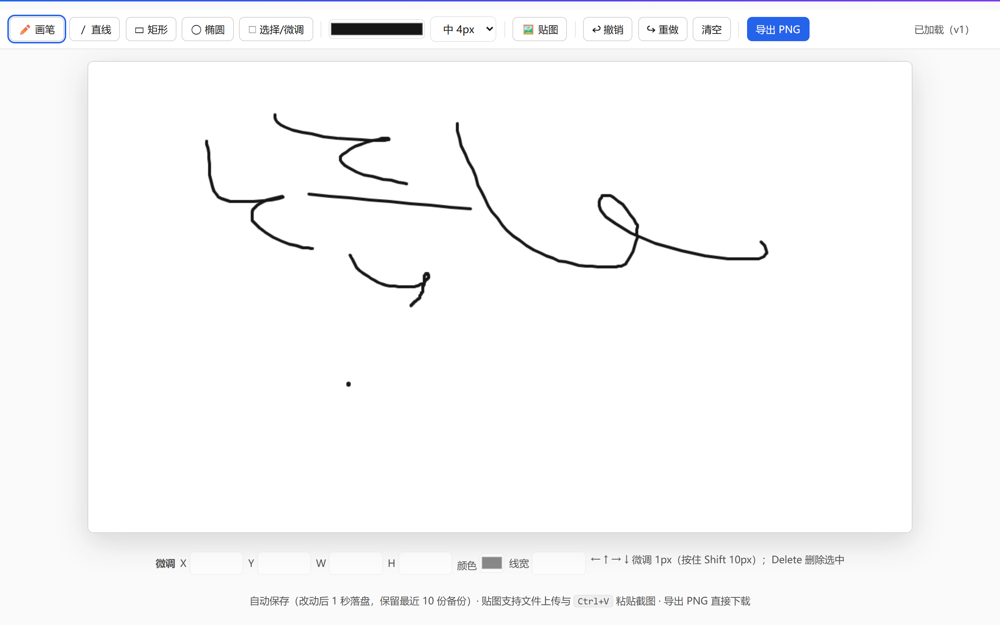

# boardweb —— 画板 Web 版（P7 的网页形态，2026-10-07 起交付）



**这个产品解决什么**：不装桌面软件也能画——浏览器里画笔/图形/选择微调、
贴图粘贴、撤销重做，自动保存 + 轮转备份，与桌面 Swing 版并存。

**Docker**（仓库根为构建上下文）：

```bash
docker build -f boardweb/Dockerfile -t kcsuite-boardweb .
docker run -p 8025:8025 kcsuite-boardweb
# 或一键全家桶：docker compose up -d --build
```

**定位**：浏览器里的画板，内嵌 Studio 门户（第九个 managed 产品）——回应
"画板要内嵌网页、要图形工具、要微调、要贴图"。桌面 Swing 版（`board/`，:8023）
保留并存，两者备份纪律同源（原子写 + 轮转留底）。

## 运行

```
run.bat                       # 双入口测试（8 项：文档/备份轮转/贴图/安全）
python server.py --port 8025  # 启动画板服务（Studio 门户可一键启停）
```

## 功能（对应四项诉求）

| 诉求 | 落地 |
|---|---|
| 各种图案 | 画笔 / 直线 / 矩形 / 椭圆四种工具 + 颜色与线宽 |
| 内嵌网页 | HTML5 Canvas 网页版，门户一键启停、浏览器直开 :8025 |
| 微调 | 选择工具点选对象 → 拖动移动 / 方向键微调 1px（Shift 10px）/ 属性面板 X/Y/W/H/颜色/线宽数字微调 / Delete 删除 / Ctrl+Z·Y 撤销重做 |
| 贴图 | 文件上传（png/jpg/gif/webp ≤8MiB）+ **Ctrl+V 直接粘贴截图**，插入后可拖动缩放 |

持久化：改动 1 秒防抖自动保存 `data/doc.json`（原子写），每次保存轮转留底
`data/backups/`（keep=10）；贴图落 `data/img/`。导出 PNG 一键下载。

## API

| 方法 | 路径 | 说明 |
|---|---|---|
| GET | /api/doc | 读文档 {version, shapes} |
| PUT | /api/doc | 保存（≤4MiB，版本 +1，轮转备份） |
| GET | /api/backups | 备份清单 |
| POST | /api/img?name=x.png | 上传贴图（≤8MiB）→ {url} |
| GET | /img/<file> | 读贴图（文件名白名单防穿越） |

## 测试策略（8 项）

文档往返与版本递增、坏体 400、备份轮转 keep=10（同秒连存不互覆——时戳掺随机）、
贴图上传取回、扩展名白名单 400、8MiB 上限 413、路径穿越 404、页面可达。

## 已知边界

- 贴图为整对象缩放（拖动/属性微调），不做像素级编辑；
- 文档为单份（无多人协作）；只绑 127.0.0.1。
