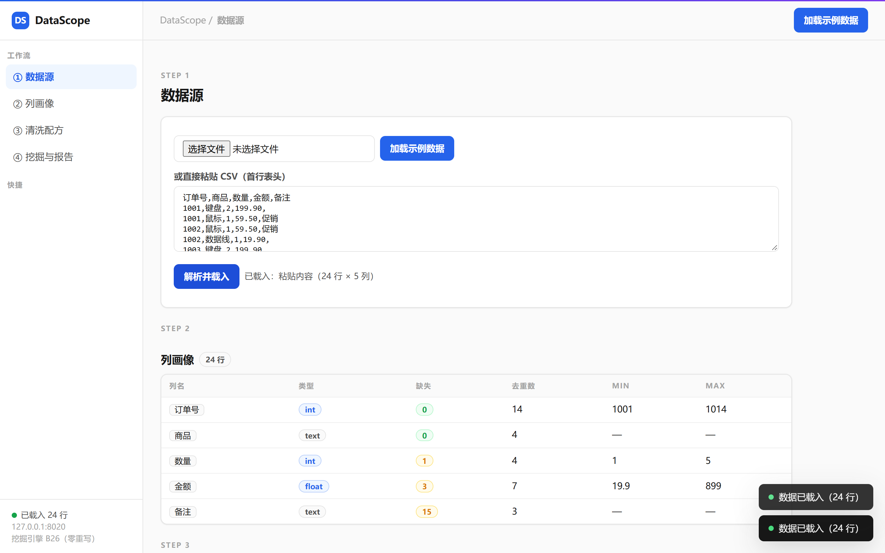

# DataScope —— 数据工作台（P4）：CSV 导入 / 画像 / 清洗管线



**这个产品解决什么**：把"发我一份 CSV"到"给出清洗报告"变成一条自助流水线——
导入 → 列画像 → 按配方清洗 → 挖掘（Apriori/K-means）→ 报告，每步计数可对账。

**Docker**（仓库根为构建上下文）：

```bash
docker build -f datascope/Dockerfile -t kcsuite-datascope .
docker run -p 8020:8020 kcsuite-datascope
# 或一键全家桶：docker compose up -d --build
```

**定位**：把"发我一份 CSV"变成产品——导入 → 列画像 → 按配方清洗 →
导出清洗后数据 + 清洗报告。**报告即账本**（继承 B26 的账本纪律）：
每个清洗步骤的计数都是"动过多少行/格"的账，不是文案。

轮四之一交付 CSV 解析、列画像、清洗步骤库、CLI；轮四之二交付挖掘适配
（B26 Apriori/K-means 真引擎）+ webframe 工作台服务；**轮四之三（本轮）收官**：
**交互式报告**（2026-10-11 ECharts 化：清洗行数变化 / 画像缺失去重 / 挖掘规则三图，
`POST /api/report_data` JSON 同源下发；悬浮读数）+ **SVG 报告导出兜底**
（`POST /api/report` → image/svg+xml，文本全转义，尺寸自适应）+ Studio 门户产品卡接入。
轮四（二）接入 B26 的 Apriori/K-means 真引擎做任务编排（支持度/置信度/提升度、
惯性/轮廓全部同源）；（吸收 B28 的血缘思想：报告里能看到数据每一步被动过什么）。

## 零件库说明（如实区分）

- B26 的 `mining/clean.py` 是**销售专用教学件**（硬编码商品表/订单字段），
  不能当通用 CSV 引擎复用——通用清洗层是 DataScope 自己的产品代码；
  但「缺陷按已知数量注入 → 报告逐笔对账」的纪律原样继承（测试即证）；
- 轮四（二）起：B26 `mining/apriori` / `mining/kmeans` 是通用实现，直接 import。

## 清洗配方（有序步骤数组）

```json
[
  {"op": "drop_duplicates"},
  {"op": "trim"},
  {"op": "to_number", "column": "qty", "on_error": "blank"},
  {"op": "drop_empty_rows", "column": "qty"},
  {"op": "fill_missing", "column": "amount", "strategy": "mean"},
  {"op": "drop_column", "column": "备注"}
]
```

| op | 参数 | 账本计数 |
|---|---|---|
| drop_duplicates | — | duplicates_removed |
| drop_empty_rows | column?（缺省=任一列空） | empty_rows_removed |
| fill_missing | column, strategy=mean/mode/value, value? | cells_filled, fill_value |
| trim | column? | rows_trimmed |
| drop_column | column | column_dropped |
| to_number | column, on_error=fail/blank | cells_converted, cells_blanked |

预检一次报全：未知 op、缺参数、列不存在，全部在同一条错误里列出。
值一律字符串进出——类型转换用 `to_number` 显式做（CSV 只有文本，装懂必踩坑）。

## 运行

```
run.bat                                   # 双入口测试（34 项）
python run.py profile 数据.csv             # 列画像（类型/缺失/去重/最值）
python run.py clean 数据.csv --recipe 配方.json --out 清洗后.csv --report 报告.json
python run.py mine 数据.csv --task apriori --params '{"group_col": "order", "item_col": "item"}'
python server.py --port 8020              # 工作台服务（Studio 门户亦可一键启停）
```

## 测试策略（34 项 = 17 清洗管线 + 14 挖掘/报告/服务）

解析（BOM/空值/空行跳过/空文件拒绝）、画像类型推断（**一个坏值整列退化为 text**）、
六个步骤各自的账本计数（缺陷数量构造时已知，报告逐笔对上）、
配方预检一次报全（未知 op + 缺参数 + 幽灵列同报）、`to_number` fail/blank 两口径、
前后画像联动（清洗后 qty 退化列恢复 int）、CLI 全链路（report JSON + 导出行数）。
挖掘对拍（Apriori 项集/规则与 K-means 标签/惯性/轮廓同源一致、坏值报行号）、
工作台 API（画像 415/清洗 400/挖掘坏任务坏列 400）、
**SVG 报告**（账本计数与挖掘规则进图、文本转义、坏配方 400）、
**报告 JSON 端点**（/api/report_data 与 SVG 同源、mining 显式 null 合法、坏配方 400）、
真套接字全链路。

## 已知边界（如实声明）

- **DataScope 三轮收官**：清洗管线 / 挖掘 / 报告 + 服务全部交付；观感归用户验收；
- 挖掘参数校验部分依赖 B26 守卫（如 k 过大、不同点不足），话术以原项目为准；
- 报告 SVG 为服务端现算产物，不落盘（需要留存时浏览器另存或调 API 存文件）。
