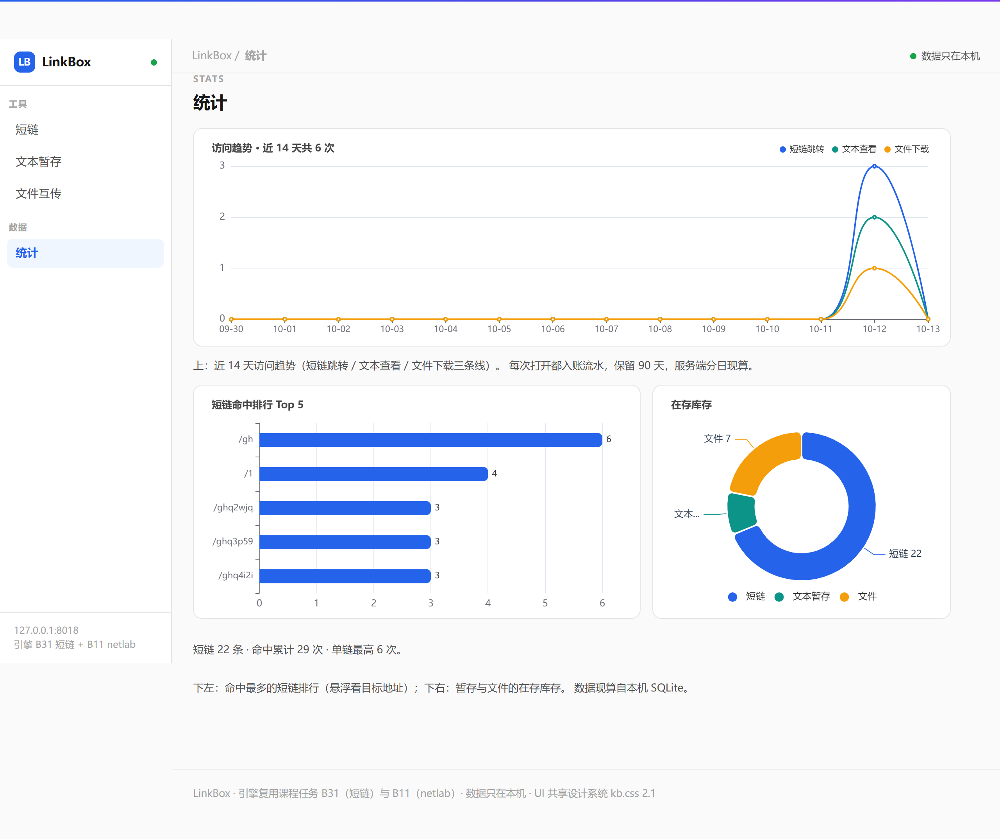

# LinkBox —— 自托管工具站（短链 / 文本暂存 / 文件互传）



**这个产品解决什么**：手机↔电脑传链接/文字/文件总要经过第三方？自己跑一个——
短链缩短、文本暂存（带过期与访问口令）、二维码取件，数据只落本机。

**Docker**（仓库根为构建上下文）：

```bash
docker build -f linkbox/Dockerfile -t kcsuite-linkbox .
docker run -p 8018:8018 kcsuite-linkbox
# 或一键全家桶：docker compose up -d --build
```

**产品定位**：一个跑在自己电脑上的工具站——短链缩短、文本暂存（带过期）、
文件互传（手机↔电脑扫码取件）。数据只在本机，浏览器可用、手机同局域网可访问。
它是课程任务 B31（短链系统）的产品化延续：**引擎复用、产品新建**——短链核心
（base62 编码 / 校验 / 存储）与协议层（netlab）直接从 B31/B11 桥接，本产品只做产品层。

## 运行

```
run.bat                    # 自测（双入口：pytest 71 / unittest 71 = 55 产品 + 16 QR，同数）+ 六段演示（不占常驻端口）
server.py --port 8018      # 启动产品服务（后台每 300 秒清扫过期条目；Ctrl+C 退出）
```

数据目录 `data/`（首次启动自动创建）：`shorturl.sqlite` 短链库（与 B31 同构）、
`stash.sqlite` 暂存库、`files.sqlite` 文件元数据库 + `files/` 字节落盘目录。
三库分离：暂存是高频写/频繁过期的临时数据，文件是大字节低频写，
与短链的生命周期不同——备份策略也该不同。

## 状态：M3 已交付（10-04）+ 轮八文件互传（10-05），P-验收等真实使用

- **M1（已交付）**：短链 + 文本暂存 + 产品页三选项卡。
- **M2 前半（已交付）**：`linkbox/qr.py` 纯标准库手写 QR 编码器
  （数字/字节模式，V1-5，ECC L/M；零依赖、零下载）。**接手时 18/21 过、3 项
  IndexError，探针仲裁出五处实现错误并全部修复**：
  1. `rs_ecc` 把按最低次存储的生成多项式当最高次用（除数反了）——整除性自测
     因同源自洽照绿，公开向量仲裁才现形（教训：性质测试 + 外部向量缺一不可）；
  2. 校正图形在 (6,6) 画了规范规定不画的 5×5，涂坏左上定位图形；
  3. 第二份格式信息 bit 7 写进黑模块格被覆盖、`(8, size-8)` 漏写；
  4. `_place_data` 未处理 V2+ 的 7 个剩余位（IndexError 根因：槽位 359 > 位流 352）；
  5. 字节模式用字符数而非 UTF-8 字节数写计数域/判容量（中文 URL 会错）。
  修复后 **16 项 QR 测试**：RS 对 Wikiversity《Reed–Solomon codes for coders》
  公开向量逐字节一致、生成多项式 α 指数与规范附录一致、ISO 数字例数据码字
  逐字节吻合、第二份格式信息 L/M × 8 掩码 16 组合全部可解码、V2 结构钉住。
- **M2 后半（本轮交付）**：
  - **二维码接线**：`/s/<码>/qr.svg` 独立路由（image/svg+xml）+ 查看页内联一份；
    编码的是查看页绝对 URL（Host 头拼装，同 B31 短链"只给人看"的口径），
    不含内容也不含口令；
  - **访问口令**：创建时可选 `passcode`；只存 PBKDF2-HMAC-SHA256
    （16 字节随机盐 + `hmac.compare_digest` 恒时比较，**210k 迭代**——OWASP 2021
    口径，2023 更新为 600k，本机实测 124ms/条，教学产品折中，登记偏离）；
    API 缺口令/错口令 → **401**，页面 → 200 + 口令表单（人看的重试路径）；
    判定次序固定 **404 → 410 → 401**；删除也要口令；过期行删除照旧 204（M1 语义）；
    **老库迁移**：打开即 `ALTER TABLE` 补口令两列（老行视为无口令），有迁移测试；
  - **M1 潜伏 bug 顺手修掉两处**：① `_code_from` 的 problem 是字符串，
    M1 曾直接 `return problem`——真触发会砸了分发层解包（测试没走到所以没炸）；
    ② 410/401 不在 B11 的 STATUS 表里——M1 的「410 已过期」在真套接字下
    从未被测过，触发即断连。已给 B11 STATUS 表补 401/410 标准短语
    （纯增量），B11（101 项）/ B31（81 项）全量重跑无回归。
- **M3（2026-10-04 已交付）**：
  - **POST 口令表单**：表单页改 `method="post"`，口令走请求体
    （`application/x-www-form-urlencoded`，类型不对 415）——不进 URL/浏览器历史；
    GET 查询串 `?passcode=` 仍兼容程序化访问；
  - **过期清扫**：`StashStore.sweep(now)` 一条 SQL 删光过期行（返回条数），
    `linkbox/sweeper.py` 后台 daemon 线程默认每 300 秒跑一轮，
    删了行才打印 `[清扫] 删除 N 条…`，失败只上报不带垮服务器；
  - `.gitignore` 收录 `linkbox/data/`。
- **轮八·文件互传（2026-10-05 已交付）**：手机↔电脑传文件的真实工具——
  - **上传** `POST /api/files?name=&ttl_hours=&passcode=`，请求体是**原始字节**
    （前端 fetch 把 File 对象直接当 body，不需要 multipart）；元数据进
    `files.sqlite`，字节落盘 `data/files/<code>.bin`——**取件路径永远是
    /f/<code>，文件名只是展示元数据，路径穿越在结构上不可能**；
  - **下载** `GET /f/<code>` 直接下发字节：`Content-Type: application/octet-stream`
    + `Content-Disposition: attachment`（RFC 5987 双文件名，中文不乱码）——
    文件永远当附件下载，不给浏览器当页面渲染（XSS 最后一道闸）；
  - **口令/过期/清扫**与文本暂存同语义：PBKDF2 210k 恒时比较、惰性过期
    （410 且行+盘同删）、后台清扫线程连 `files/` 一起收；
  - **二维码** `/f/<code>/qr.svg`：编码下载页绝对 URL，扫出即下载；
  - **传输层放宽**：netlab 默认 max_body 1 MiB（为 JSON 设计）→ 装配时放宽到
    32 MiB+4 KiB；应用层仍有 MAX_FILE_BYTES 精确限额与空体 400；
  - **前端**：首页新增「文件」选项卡（选文件/TTL/口令 → 上传 → 得链接）；
  - **测试** 41 → **53 项**（+12：往返逐位一致/元数据与删除/空体与非法 TTL/
    惰性过期连盘清/口令三态与表单 POST/QR 确定性/safe_name 白名单/
    RFC 5987/超限拒绝/sweep 连盘清/真套接字 1 MiB 上传下载逐位一致）；
  - **浏览器走查（10-05）顺手抓出一处 M1 潜伏缺陷**：统计页读
    `r.data.links / r.data.hits`，而 /api/stats 实际返回
    `{stats:{links, total_hits, …}}`——「链接总数/命中总数」自上线起一直显示
    undefined。已改为读 `r.data.stats.links / r.data.stats.total_hits`，
    浏览器复验两个数字正常（接口无测试覆盖前端字段——这就是潜伏一整轮的原因，
    已在练习建议里记一笔）。
- **P-验收待用户**：真实使用 ≥1 周（有访问/写入记录）、3 个用户故事闭环——
  这两条 AI 不代勾，见根 PRODUCTS.md §三。

## 功能（M1）

- **短链**：创建（自定义短码可选）/ 302 跳转 / 命中统计 / 最近列表
  ——与 B31 完全同源，URL 校验 13 条规则全保留
- **文本暂存**：`POST /api/stash`（content + ttl_hours）→ 得到 `/s/短码`
  查看页；到期惰性清除（访问时删除并返回 410）；可提前 DELETE
- **产品页**：响应式（手机同网段可用）、短链/暂存/统计三选项卡
- **HTTP API**：见下表

| 方法 | 路径 | 说明 |
|---|---|---|
| POST | /api/links | 创建短链 {url, alias?} |
| GET | /api/links | 最近列表 |
| GET | /l/<code> | 302 跳转 |
| GET | /api/links/<code> | 单条统计 |
| GET | /api/stats | 总览 |
| POST | /api/stash | 新建暂存 {content, ttl_hours?, passcode?} |
| GET | /api/stash/<code> | 读暂存（过期 410；设口令需 ?passcode=，缺/错 401） |
| DELETE | /api/stash/<code> | 提前删除（设口令需 ?passcode=） |
| GET | /s/<code> | 暂存查看页（内容 HTML 转义；内联二维码；设口令先见表单页） |
| POST | /s/<code> | 口令表单提交（表单体带 passcode，不进 URL） |
| GET | /s/<code>/qr.svg | 查看页二维码（编码查看页 URL） |
| POST | /api/files?name=&ttl_hours=&passcode= | 上传文件（请求体=原始字节，≤32 MiB） |
| GET | /api/files/<code> | 文件元数据（过期 410；设口令需 ?passcode=，缺/错 401） |
| DELETE | /api/files/<code> | 提前删除（行+盘一起清） |
| GET | /f/<code> | 下载字节（attachment 头；设口令先见表单页） |
| POST | /f/<code> | 文件口令表单提交（成功即下载） |
| GET | /f/<code>/qr.svg | 下载页二维码（编码下载 URL，扫出即下载） |
| GET | /api/stats/clicks?days=&kind= | 访问趋势（2026-10-12：逐日流水 + 分线 + Top 排行） |

状态码口径：400 内容不合法 / 401 设口令的暂存缺口令或口令不对 /
404 不存在 / 410 已过期 / 413 超长 / 415 类型不对 / 503 容量满。

## 产品化相对 B31 的新增

- **文本暂存**：新表 + 新路由 + 惰性过期（B10 的"访问时清理"经验直接搬）
- **产品页**：单页双选项卡，业务判定全在服务端（前端只渲染）
- **数据目录**：`data/` 自动创建，短链库与暂存库分文件
- **XSS 防线**：暂存内容进 HTML 前一律 `html.escape`，并有回归测试
  （脚本注入必须显示为转义文本）

## 测试策略（双入口：pytest 71 / unittest 71 = 55 产品 + 16 QR，同数）

产品测试（88 项，双入口同数；2026-10-07 现算）：

- 暂存闭环（创建→API 读回）、查看页 XSS 转义回归
- 过期：注入时钟推过有效期 → 410 + 惰性删除 + 计数核对
- 校验：空内容/超长/非字符串/非法 TTL/未知字段/口令类型长度 → 全 400
- 口令：API 缺/错 401、对口令 200、页面表单流、删除也要口令、
  过期不因口令隐藏、不设口令的 M1 回归
- 二维码：独立路由确定性 SVG、Host 头拼装、未知码 404
- M3：POST 表单流（错/对/415）、sweep 只删过期行、清扫真线程（50ms 轮）上报与停止
- 老库迁移（M1 无口令列 → 打开即迁移可用）
- 删除：204 → 404
- 产品化回归：短链 create→redirect 302 与 Location 头不因产品化受损
- L3 删除管理（2026-10-07）：DELETE /api/links 闭环（204→跳转 404→重复删 404→
  账面归零）、坏短码 400、查看页自带删除表单（无口令直删；设口令的错不删、
  对才删）、真套接字 DELETE 204→404
- 产品首页可达；真套接字四条（暂存闭环 + 产品页 + 口令全链路含 %xx 解码 + 文件 1 MiB 往返）
- 轮八文件暂存（12 项）：上传下载逐位一致（中文名）、元数据与删除、
  空体/非法 TTL 400、惰性过期连盘清、口令三态（表单页/错口令提示/POST 即下载）、
  QR 确定性且不含口令、safe_name 剥路径与控制字符（中文保留）、
  RFC 5987 Content-Disposition、超限 FileError、sweep 行+盘同清、
  真套接字 1 MiB 传输（钉住 max_body 放宽）

QR 测试（16 项，全部有外部出处，见上文 M2 前半）：
公开向量三条（RS 消息→ECC、生成多项式指数表、ISO 数字例数据码字）、
RS 整除性独立验证、GF 性质、V1/V2 结构、第一/第二份格式信息 BCH
（后者 16 组合全覆盖）、掩码惩罚分、UTF-8 字节计数、确定性、容量上限、SVG。

## 已知局限

- 单进程；无账号体系（暂存是"凭链接查看"的匿名模型）；
- 文件上传把请求体整体读进内存再落盘（netlab 的请求模型）：32 MiB 上限
  即内存上界——单用户局域网工具够用，多人/大文件场景需要流式改造；
- GET 查询串 `?passcode=` 仍受支持：程序化访问会进 URL/历史——
  浏览器路径已改 POST 表单（M3），程序化路径的取舍登记在案；
- 二维码里的 URL 按 Host 头拼装：客户端可控，只用于"给人扫"；
  放公网要改成配置域名（同 B31 短链的口径）；
- PBKDF2 取 210k 迭代（OWASP 2021 口径）：OWASP 2023 建议 600k，
  本机单用户场景折中，登记偏离；
- 惰性过期 + 定时清扫并存：访问时删 + 每 300 秒扫一轮；
- 文本内容上限 100 KB；文件上限 32 MiB；TTL 上限 1 年。

## 练习建议

1. 清扫日志落盘：`[清扫]` 行写进 `logs/`（PRODUCTS.md 共享地基的日志目录口径）。
2. 统计页字段没有前端测试（M1 的 undefined 潜伏一整轮才被浏览器走查抓出）——
   给 web/ 的表单与渲染补一层轻量 DOM 冒烟测试是下一步最值当的练习。
3. 用 B30 的一致性哈希把 stash 拆到两个"存储节点"——顺便理解为什么
   教学版先不做。
