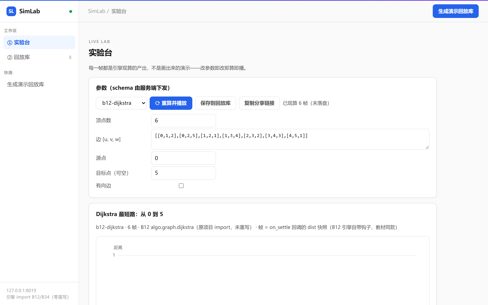

# SimLab —— 仿真馆（P5）：真实引擎的运行记录与回放



**这个产品解决什么**：演示常见于"画出来的动画"——SimLab 的每一帧都是
真实引擎（B12 Dijkstra/背包 DP、B34 A*）现算的产出，改参数即改即算。

**Docker**（仓库根为构建上下文）：

```bash
docker build -f simlab/Dockerfile -t kcsuite-simlab .
docker run -p 8019:8019 kcsuite-simlab
# 或一键全家桶：docker compose up -d --build
```

**定位**：终结"PPT 式演示"——showcase 页是静态回放，SimLab 是
**参数 → 真实引擎现算 → 统一运行记录 → 播放器回放**。
轮三之一交付记录格式与引擎适配器；**轮三之二（本轮）交付播放器服务**：
跑在自研 webframe 上，记录库（列/读/现算落盘）+ 帧回放 UI
（播放/步进/拖动时间线，三种实验各有渲染器）。Studio 门户已把它收进产品卡。

## 零件库纪律（本包最重要的约束）

**引擎一律 import 原项目的真实实现，simlab 不重写第二套算法。**

| 实验名 | 引擎（原项目，直接 import） | 帧的来源（全部是引擎真实产出） |
|---|---|---|
| `b12-dijkstra` | B12 `algo.graph.dijkstra` 的 `on_settle` 回调 | 每轮选点时的 dist 快照（教材同款） |
| `b12-knapsack` | B12 `algo.dp.knapsack_table` + `knapsack` | DP 表逐行 + 引擎回溯的选中方案 |
| `b34-astar` | B34 `planner.search.best_first`（h=0 即 Dijkstra） | `SearchResult.expanded` 展开序列逐格前缀 |

B9 是 C 项目，没有可 import 的 Python 调度引擎——按"不重写第二套"纪律
**不接入**（如实登记，等有了可复用的实现再说）。

## 运行记录 simlab-run/v1

```json
{
  "format": "simlab-run/v1",
  "experiment": "b34-astar",
  "title": "A*（h=manhattan）网格寻路：5×4，3 个障碍",
  "engine": "B34 planner.search.best_first（原项目 import，未重写）",
  "params": {"width": 5, "height": 4, "walls": [[1,1]], "start": [0,0], "goal": [4,3]},
  "frames": [{"t": 0, "caption": "展开第 1 格 (0, 0)", "state": {"expanded": [[0,0]]}, "highlights": [[0,0]]}],
  "metrics": {"found": true, "cost": 6.0, "path": [[0,0],[1,0],[2,0],[3,0],[4,0],[4,1],[4,2],[4,3]], "expanded_count": 17},
  "created_at": 1696000000.0
}
```

校验器一次报全所有问题；`save` 用 `allow_nan=False`——Infinity/NaN 在落盘那一刻
就炸（JSON 没有无穷大，引擎的 dist 快照已由适配层把 inf 转成 null）。

## 运行

```
run.bat                                  # 双入口测试（37 项）
python run.py --list                     # CLI：列出可用实验
python run.py b12-knapsack --params-file params.json --out runs\demo.json
python server.py --port 8019             # 播放器服务（浏览器打开后选记录或现算）
```

## 播放器服务（轮三之二）

| 方法 | 路径 | 说明 |
|---|---|---|
| GET | /api/records | runs/ 目录记录列表（元数据；坏记录如实标 invalid+原因） |
| GET | /api/records/<name> | 读完整记录（名字白名单 + resolve 双保险） |
| POST | /api/records | **现算一份并落盘**：引擎现算 + simlab 校验器先验 → 201 |
| GET | /api/params/<experiment> | 参数 schema（类型/默认值/说明），前端据此生成表单 |
| POST | /api/render | **实时重算（不落盘）**：{experiment, params} → 记录，runs/ 零垃圾 |

页面（轮三之三）：选实验 → schema 驱动的参数表单（数字/勾选/下拉/JSON 文本域，
默认值即可跑通）→ "⟳ 重算并播放"即改即算即播 → "保存到记录库"才落盘。
渲染器：Dijkstra 顶点距离表（已确定/本轮确定高亮）、背包累积 DP 表（当前行高亮）、
A* SVG 网格（墙/已展开/当前格/终局描路径）。播放/步进/拖动时间线全在客户端，
帧数据零加工——全是服务端现算的引擎产出。

## 测试策略（37 项 = 24 地基 + 9 播放器 + 4 实时重算）

记录格式：build/validate/save/load 往返、**问题一次报全**、帧 t 与下标绑定、
caption/state 必填、**非有限浮点落盘即炸**、坏 JSON 读入。
引擎对拍（metrics 与直接调用原引擎同源）：dijkstra 的 dist/path、
knapsack 的 best/chosen、astar 的 cost/expanded_count/path；
帧结构断言（settle 快照单调、表行数、展开前缀）；
**可采纳启发式扩展数 ≤ h=0**（B34 核心教学点）；
引擎守卫负例（负权边/长度不一致/起点在障碍里）；
**确定性**（同参数两次运行剔除 created_at 逐字节一致）；
CLI（出合法记录 / 未知实验 exit 2 / 坏参数 exit 2）。
播放器：现算落盘（记录过自家校验器）、列表元数据口径、读取、未知实验 400、
引擎守卫话术透传 400、坏 body 400、**记录名白名单与穿越拒绝**、缺失 404、
**坏记录如实标注 invalid**、首页与静态、真套接字全链路。
实时重算：schema 端点（三实验 schema 齐全且**默认值即可跑通**）、未知实验 404、
**render 不落盘**（runs/ 原封不动）、引擎守卫话术透传 400。

## 已知边界（如实声明）

- **SimLab 三轮收官**：记录格式 / 引擎适配 / 播放器 + 实时重算全部交付；
  观感归用户双击验收（P-验收同款，AI 不代勾）；
- 引擎参数校验依赖原项目守卫（B12 的 `_validate`、B34 的 `require_free`），
  适配层只补 JSON 形状检查——错误话术以原项目为准；
- 随机实验（需要 seed 的）暂无：现有三引擎全确定性，seed 字段已预留。
