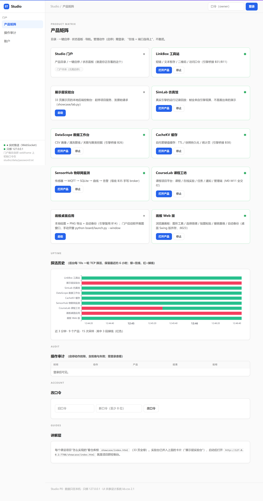

# Studio —— 产品矩阵门户（P0）



**这个产品解决什么**：作品集有了入口——九个产品一眼看清"做了什么、活没活着"：
产品目录、一键启停、TCP 探活状态面板（在线 = 端口连得上，不撒谎）、统一导航。

**Docker**（仓库根为构建上下文）：

```bash
docker build -f studio/Dockerfile -t kcsuite-studio .
docker run -p 8017:8017 kcsuite-studio
# 或一键全家桶：docker compose up -d --build
```

**定位**：课设产品矩阵的入口——产品目录、一键启停、状态面板、导航。
**门户本身跑在自研 [webframe](../webframe/README.md) 微框架上**（netlab 协议层
+ 本框架路由/静态/JSON 管线），是"框架是真交付物"的现场证明。

## 运行

```
run.bat                    # 自测（24 项）+ 四段演示（不占常驻端口、凭据用临时目录）
server.py --port 8017      # 启动门户（浏览器打开 http://127.0.0.1:8017/）
```

门户默认管理 127.0.0.1:8018 的 LinkBox 与 127.0.0.1:7788 的展示层实验台
（启动均用真实子进程；LinkBox 磁盘模式数据在 `linkbox/data/`）；`--linkbox-port`/`--lab-port` 可改。
只绑 127.0.0.1。

## 登录（轮二新增）

- **单用户 owner**：首次启动自动生成初始口令，写在 `studio/data/password.txt`
  （该目录已进 .gitignore）；管理动作（启停）要求登录，目录与状态只读公开；
- **会话**：webframe 签名 cookie（HMAC-SHA256 + 恒时比较），密钥落盘
  `studio/data/secret.key`——门户重启不掉会话；
- **改口令即踢会话**：口令文件带世代号，改口令后旧世代会话全部要求重新登录
  （签名 cookie 无服务端状态、logout 只能覆盖客户端 cookie——世代号补上了服务端失效语义）；
- 页面右上角登录/登出，下方改口令面板。

## 能做什么

- **产品目录**：矩阵照抄根 PRODUCTS.md——九个产品全部 managed 给启停按钮
  （LinkBox、展示层实验台、SimLab、DataScope、CacheKV、SensorHub、CourseLab、画板），
  **已规划清零**；
- **状态面板**：在线 = TCP 探活连得上，不撒谎；每 3 秒刷新；
- **一键启停**：启动为门户的子进程，停止 = terminate
  （LinkBox 用 SQLite，进程被杀不损数据）；**不是门户启动的进程不许 stop**
  （不知道那是什么，409 拒绝）；
- **导航**：在线产品一键打开产品页（实验台直达 showcase 项目群控制台）。

## HTTP API

| 方法 | 路径 | 说明 |
|---|---|---|
| POST | /api/login | 登录 {username, password}（错 → 401 统一话术） |
| POST | /api/logout | 登出（强制回写空会话覆盖旧 cookie） |
| GET | /api/me | 当前会话用户 |
| POST | /api/password | 改口令 {old, new}（需登录；新 ≥8 位；改后旧世代会话全失效） |
| GET | /api/products | 全量目录 + 在线状态（现探测）+ 当前用户 |
| GET | /api/products/<id>/status | 单产品状态 |
| POST | /api/products/<id>/start | 启动（需登录；已在线 409；已规划 400；启动后探活直到在线/超时） |
| POST | /api/products/<id>/stop | 停止（需登录；离线幂等 200；非门户启动 409） |
| GET | /api/audit | 操作审计（M2；需登录；启停含拒绝/失败的追加账） |
| GET | / | 门户首页（webframe 静态管线 + `/static/*` 资产） |

## 测试策略（24 项）

认证流（未登录 me 空 → 错口令 401 统一话术 → 登录得会话 → 登出回写空会话）、
改口令（未登录 401 / 旧口令错 / 新口令过短 / 成功后旧口令失效 + **旧世代会话 401**）、
凭据落盘跨重启、矩阵对齐（门户 + 九个 managed，**已规划清零**——除门户自身外
全部 managed，残留 planned 即登记错误）、
状态与未知产品 404、首页与静态资产、**启停鉴权**（未登录 401）、
**八产品真启停**（LinkBox/实验台/SimLab/DataScope/CacheKV/SensorHub/CourseLab
各一条真子进程生命周期：start → 探活在线 → stop 离线幂等；画板的契约差异：
stop 终止的是 launch.py 启动器，java 守护靠父进程看门狗秒级跟进——离线断言带
8s 截止轮询，顺带验证看门狗把进程收干净）、
**非本门户进程 stop 409**（测试自清理孤儿）、真套接字目录+首页。
（原「已规划 start 400」用例随 planned 清零退场；API 分支保留给未来登记。）

**M2 操作审计（2026-10-07，+3）**：审计读取要登录（未登录 401；无账本时
登录后空账也 200）；真启停 Manager 挂账本——拒绝（已规划/已在线）与成功
（start/stop ok）如实入账、幂等空操作不记（stop 事件数==真停次数）、
账本落盘跨 AuditLog 实例（重启）仍在；**跨线程回归（10-08 走查抓出）**——
构造线程只建对象、record/tail 全在另一线程（事件循环形态）跑，旧实现必红，
修复=惰性连接 + check_same_thread=False（锁已串行化全部访问）。

## 已知局限

- 签名 cookie 无服务端状态：logout 只能覆盖客户端 cookie（世代号补上了
  "改口令踢全站会话"的服务端失效）；单设备单人场景够用；
- start 的探活超时 10 秒：超时仍报 offline（进程可能活着但没监听——如实显示）；
- 停止 = TerminateProcess：LinkBox 数据安全（SQLite 崩溃安全），实验台自身无状态；
  其他产品接入时逐个评估；
- 前端 3 秒轮询：不做 WebSocket（产品量级不需要）。
